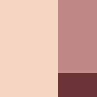

# NatureColors

**Three colors from nature. One palette for your project.**

NatureColors is an AI skill for picking colors for a website, brand, post, graphic, or video. Describe what you're making and how it should feel. The skill offers three palettes from a catalog inspired by nature photography and observation imagery.

### Red Onion

60% `#F7D6C1` · 30% `#BE8985` · 10% `#6D3438`

*If nature says it goes, it goes.*

## Try it

Copy the [`nature-colors`](nature-colors) folder into your AI client's skills directory. In a Codex repository, that can be `.agents/skills/nature-colors`. Use `/nature-colors` in clients that expose skills as slash commands or choose `$nature-colors` in Codex. You can also ask in your own words.

> Pick colors for a calm ceramics studio website with a light background.

The first reply gives you one palette per style:

- **Professional** keeps the composition restrained with neutral or muted colors.
- **Brave** pairs two quieter colors with one expressive focal color.
- **Crazy** combines three expressive hues that make an unexpected trio.

Each palette comes with an English name, three copyable HEX codes, and a square preview showing 60% dominant, 30% supporting, and 10% accent. Pick one, two, or all three. Ask for alternatives in any style, or ask the skill to apply your selection.

## Catalog status

This public preview includes **414 palettes**. Browse them [by style](examples/style-board.svg) or open the [subject board](examples/produce-board.svg). The [flower board](examples/flower-board.svg) and [animal board](examples/animal-board.svg) show those collections separately.

The [catalog](nature-colors/references/palettes.json) contains 319 image-based palettes awaiting approval. Each entry records an English name, three colors in role order, and its review status. Ask for early color studies to explore the [95 additional food palettes](nature-colors/references/color-studies.txt). The stable release is planned for 200 approved palettes.
